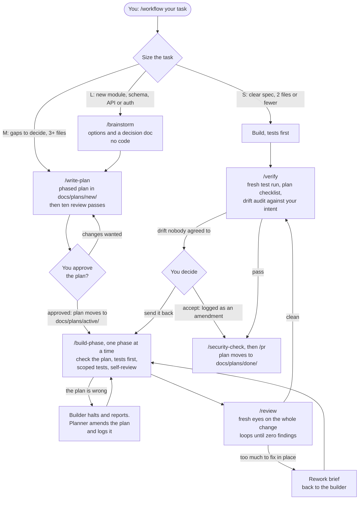
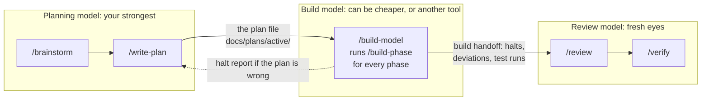

# Agentic-workflow

Skills, hooks and installers that make an AI coding agent work in a fixed order: **brainstorm → plan → build → review → verify**. Works with Claude Code, Cursor, Codex and Gemini CLI.

The idea is **intent-audited development**. You decide what to build and that decision is written down. Your strongest model plans it and checks the result; a cheaper model (or another tool) can do the building. Nothing counts as done until the finished work has been checked against what you originally meant, with a test run made in this session as proof.

## How it flows



**Why it works**

- **Intent is written down and locked.** `/brainstorm` records what you chose, what you ruled out and what users will see. After you approve the plan, only you can change it.
- **The plan is a file, not a chat.** It names every decision, so a cheaper model can build it without guessing.
- **The builder stops instead of improvising.** If the plan has a gap, it reports back; the planner fixes the plan and logs the change.
- **Review owns the code.** It looks through seven lenses (impact, removal, logic, behaviour, business sense, proof, coherence), one at a time, and repeats until a round finds nothing.
- **Drift blocks "done".** `/verify` compares your intent to the plan and the plan to the code. A difference nobody agreed to stops the claim.
- **Hooks enforce it.** No source edits without an approved plan, an append-only change log, no secret-file edits.
- **Token-aware.** Small tasks skip the ceremony, tests are scoped per gate, and each skill's long explanations load only when a step needs them.

## 1. Install

```bash
git clone https://github.com/jaibhortake/Agentic-workflow.git

# macOS / Linux / Git Bash
./Agentic-workflow/install.sh path/to/your-project

# Windows PowerShell
.\Agentic-workflow\install.ps1 -Project path\to\your-project
```

The default tool is Claude Code. For others add `--tool cursor`, `--tool codex`, `--tool gemini`, `--tool all`, or a list such as `--tool claude,gemini` (PowerShell: `-Tool`). Re-run after `git pull` to update; your own settings are kept.

**Claude Code plugin instead** (skills, agents and hooks, updated with `/plugin update`):

```
/plugin marketplace add jaibhortake/Agentic-workflow
/plugin install agentic-workflow@agentic-workflow
```

## 2. First run: create your project's `CLAUDE.md`

Open the project in your agent and run **`/setup-project`** (Cursor, Codex, Gemini: ask the agent to run the `setup-project` skill). It reads your repo, finds the real install, test and lint commands, and fills in the project facts file: `CLAUDE.md` for Claude Code, or a `## Project` section at the bottom of `AGENTS.md` for the other tools. It also fills your test and format commands into `.claude/workflow.json`.

What the installer put in your project:

| Path | What it is |
|---|---|
| `AGENTS.md` | The workflow rules, in a marked block that re-installs replace safely. Read by every tool |
| `CLAUDE.md` | Imports `AGENTS.md`, then holds your project facts (Claude Code) |
| `GEMINI.md` | Imports `AGENTS.md` (Gemini CLI) |
| `.claude/skills/` | The skills, as slash commands (Claude Code). Cursor, Codex and Gemini use `.agents/skills/` |
| `.claude/agents/`, `.claude/hooks/`, `.claude/settings.json` | Sub-agents and safety hooks (Claude Code only) |
| `.claude/workflow.json` | Your settings (see below) |
| `docs/plans/{new,active,done}/` | Plans: drafts, approved and being built, finished |
| `docs/decisions/` | Decision docs written by `/brainstorm` |

## 3. How to use the skills

You only need to remember one command: **`/workflow <what you want>`**. It sizes the task, tells you the path, and drives the phases. Everything below is what happens, and what you can type yourself.

**A small fix (S).** Clear spec, two files or fewer.
```
/workflow fix the off-by-one in the pagination helper
```
It builds with a failing test first, then runs `/verify`. No plan file. For a bug it runs `/debug` first: find the root cause, fix it, add a regression test.

**A medium feature (M).** Some decisions to make, or three or more files.
```
/workflow add CSV export to the reports page
```
It runs `/write-plan` and saves a phased plan to `docs/plans/new/`. Read it like code. Reply "approved" (or ask for changes) and the plan moves to `docs/plans/active/`. Then `/build-phase` builds it phase by phase, `/review` checks it, `/verify` closes it.

**A large feature (L).** New module, or a schema, API or auth change.
```
/brainstorm offline support for the sync layer     # options, risks, a decision doc; no code
/decision-summary                                  # any time: what has been decided, in plain words
/write-plan offline-sync                           # the phased plan
                                                   # you approve; the decision doc is now locked
/build-phase docs/plans/active/offline-sync.md 1   # phase 1; repeat per phase (it drives this itself)
/review                                            # loops until clean
/verify                                            # fresh evidence + drift audit
/security-check
/pr
```
`/workflow` drives the middle steps for you; you mostly approve the plan and read the final verify report.

**Hand the build to a cheaper model.** Plan with your strongest model, then in a second session (Sonnet, Cursor, Codex, Gemini, a local model) run:
```
/build-model docs/plans/active/offline-sync.md
```
It checks the plan, builds every phase, reviews its own work, writes a handoff summary and stops. Paste that summary into your main session: it re-reviews with fresh eyes and runs `/verify`. If the builder finds the plan wrong it halts with a report instead of guessing.



**Long sessions and getting back into it.**
- `/compact-brief` writes a one-line compact command plus a resume brief to paste after it, so work survives a context compaction. `/handoff` does the same for a fresh session or a teammate.
- `/triage` recommends what to pick up next from your plans, handoffs and issues.
- `/learn` saves what a finished task taught you to `docs/lessons.md`.

**Everyday settings.**
```
/models build=sonnet review=opus explore=haiku   # a model per role
/workflow-config rigor=strict testing=bdd terse=lite
/terse off                                       # full-prose output
/backlog bug "login fails on empty password"     # GitHub Issues, if enabled
```

## What each skill does

**The lifecycle**

| Skill | What it does |
|---|---|
| `/workflow` | Entry point. Sizes the task (S/M/L), routes it, and holds the rules every other skill follows |
| `/brainstorm` | Explores the problem before any plan: approaches with trade-offs, challenges the obvious one, writes a decision doc. Never writes code |
| `/write-plan` | Writes a phased plan a cheaper model can build without guessing, then runs ten review passes on it |
| `/build-phase` | Builds one phase of an approved plan: reviews the plan, writes tests first, runs scoped tests, self-reviews. Stops and reports if the plan is wrong instead of improvising |
| `/build-model` | For a separate, cheaper build session: builds every phase, reviews, writes the handoff, then stops |
| `/review` | Independent review of the built change against the decision doc and plan. Loops until no findings are left; sends too-large rework back as a brief |
| `/build-handoff` | Writes the fixed-format record of a build: halts, deviations, test runs, unproven criteria, concerns |
| `/verify` | The final gate. Fresh test run, line-by-line check against the plan, and a drift audit from decision doc to plan to code. Nothing is "done" without it |
| `/debug` | Finds the root cause before fixing, then requires a regression test |
| `/security-check` | Pre-PR check for secrets, injection, auth, data exposure and dependencies |
| `/pr` | Writes the PR title and description from the plan and verify evidence |

**Around the lifecycle**

| Skill | What it does |
|---|---|
| `/triage` | Recommends what to work on next from plans, handoffs and issues, without wasting loaded context |
| `/backlog` | GitHub Issues: file bugs and features, link a plan to its issue, close after verify |
| `/decision-summary` | Plain-words recap of what has been decided so far. Changes nothing |
| `/compact-brief` | One-line compact command plus a resume brief, so work survives a context compaction |
| `/handoff` | Resume notes for a fresh session or a teammate |
| `/learn` | Saves lessons from a finished task to `docs/lessons.md` |
| `/terse` | Short output while building and debugging. Plans, reviews and PR text stay in full prose |
| `/models` | Choose the model for each role (plan, build, review, explore) |
| `/workflow-config` | Change settings in `.claude/workflow.json` |
| `/setup-project` | Fills in your project facts file (step 2) |

**Used by the skills above (not run directly)**

| Skill | What it does |
|---|---|
| `existing-mechanisms` | Eight questions about what the codebase already does, so nothing is duplicated or orphaned |
| `review-lenses` | The seven review lenses plus security, and the brief for handing a review to another model |
| `test-scope` | How wide each test run must be, and when an earlier run may be cited |
| `knowledge-graph` | How to use a [graphify](https://github.com/Graphify-Labs/graphify) index, if you have one |
| `test-driven-development`, `systematic-debugging` | Test-first and root-cause discipline, from [obra/superpowers](https://github.com/obra/superpowers) (MIT) |

Each skill's `SKILL.md` is the short, binding version. Its `references/` folder holds the full explanation and examples, loaded only at the step that needs them.

## Hooks (Claude Code)

Rules in markdown are advice; hooks always run.

- `guard.sh`: blocks edits to `.env` and key files, destructive commands, and edits to a frozen decision doc.
- `plan-gate.sh`: blocks source edits until a plan is approved in `docs/plans/active/`. For an S task, write one line to `docs/plans/.s-task` first. Docs, tests and config always pass.
- `amendment-guard.sh`: an active plan's Amendment Log is append-only.
- `format-on-edit.sh`: runs your `formatCommand` on each edited file.
- `verify-on-stop.sh`: runs your `testCommand` before the agent may finish; failing tests send it back.

## Settings

In `.claude/workflow.json`; change them with `/workflow-config`.

| Key | Meaning |
|---|---|
| `testCommand`, `formatCommand`, `baseBranch` | Filled by `/setup-project` |
| `rigor` | `standard` or `strict` (L tasks always run strict) |
| `planGate` | `true` turns on the plan-gate hook. Existing projects add this line themselves |
| `testing` | `tdd` or `bdd` |
| `terse` | `off`, `lite`, `full`, `ultra` |
| `useGithubIssues` | `true` enables `/backlog` |
| `models` | Per-role models, or use `/models` |

## License

MIT License
