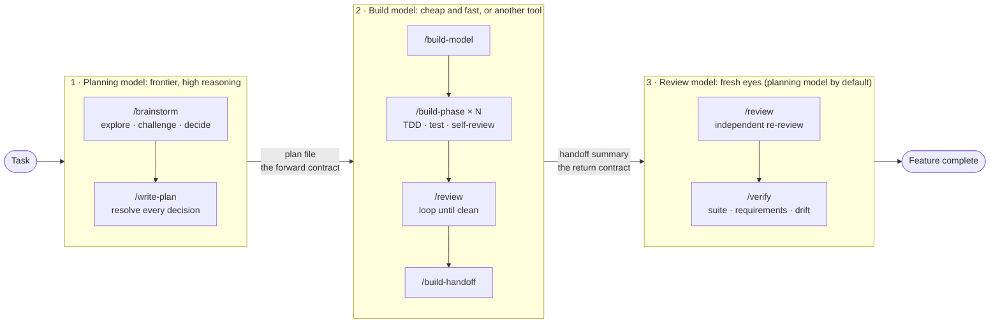

# The multi-model split

*Buy expensive reasoning once. Spend cheap execution as often as you like.*

The plan is a **file**, not a conversation, so planning and building can run on different models, tools or sessions. The frontier model spends its reasoning on intent and on checking the work against it; cheaper models do the typing in between.

## The problem it solves
Frontier reasoning is the scarcest resource: most expensive per token, first to hit a usage limit, and the thing that separates a good architecture from a mess. Most tokens a coding agent burns are mechanical (reading files, boilerplate, running the suite, fixing an import, running it again) and need a competent, fast, cheap model. The usual failure is spending frontier tokens on all of it and finishing the feature with a degraded context and a tired plan.

## Three roles (two mandatory; they may be the same model)
| Role | Does | Needs | Reasonable choices |
|---|---|---|---|
| Planning model | `/brainstorm`, `/write-plan`: explores, challenges, resolves every decision, writes the plan | deep reasoning, long context, architectural judgment | your best model |
| Build model | `/build-model` -> `/build-phase` per phase -> `/review` -> `/build-handoff` | accurate code generation, tool use, patience | a mid-tier model (e.g. Sonnet-class), or Cursor, Copilot, Gemini Flash, Codex, a local model |
| Review model (optional) | `/review` on the returning change set, then `/verify` | fresh eyes, no authorship bias | usually the planning model; occasionally a deliberately different third model |

By default the planning model also reviews and verifies; splitting the reviewer out is an upgrade, not a requirement. Pick models per role with `/models`. **Fix the plan, not the tier:** halts rise as a model's tolerance for ambiguity falls, so on a thin plan a cheaper model isn't cheaper, it just fails earlier and more honestly. A tier too weak to hold the review bar costs the rework it was meant to save. Mechanical breadth work (grep, enumerate call sites, summarise a module) goes to the cheapest subagent tier, briefed to return findings not file contents; never delegate the trade-off analysis or the plan.

## Two contracts, no shared conversation
- **Forward: the plan file** (`docs/plans/active/<feature>.md`). Exact paths, signatures, test commands with expected output, named seam tests, failure-mode analysis, and a hard rule against "choose an appropriate X". Anything ambiguous is a decision the builder makes silently at the worst moment.
- **Return: the build handoff** (`build-handoff`): plan revision built against, every halt and its resolution, every deviation, verification runs with rungs and mutation checks witnessed, unproven criteria, concerns. The user carries it back; the main model runs `/review` **again** with it as input, then `/verify`.
- **The plan is amended on the forward path, never the return path.** A halt travels back as a report; the planner amends and logs; the amended plan travels forward. The builder never edits the plan, which is what makes the final drift audit possible.

## What it costs and saves
Planning gets more expensive (thoroughness is tokens). Building gets much cheaper (the bulk-token phase leaves the frontier model). Rework nearly disappears: the expensive failure was never token spend, it was discovering in phase 4 that the data model was wrong. Plans accumulate in `docs/plans/new/` while a build session works through an earlier one, so planning and implementation velocity stop being the same number.

## Running it
1. **Plan** in the strong model: `/brainstorm`, `/write-plan`; review; on approval the plan moves to `active/`.
2. **Hand off:** a session in the build tool, `/build-model docs/plans/active/<feature>.md`. It runs every phase, reviews, emits the handoff and **stops**.
3. **Return:** paste the handoff into the planning model. It runs `/review` with it as input, loops until clean, then `/verify`, then archives the plan.
The build model needs the workflow skills installed in its environment (every skill is a plain `SKILL.md`; Claude Code, Cursor, Gemini CLI and Copilot read them). `docs/extras/driving-an-agent-as-build-model.md` is a generic recipe for driving another CLI headless.

## Expect halts, and read them correctly
The builder builds what the plan names and halts rather than inventing a way around a gap. That converts every plan gap into a halt: budget a relaunch or two and read a halt as a defect in *your plan*, not the builder underperforming. Most are front-loaded because `/build-phase` opens with a **plan review**, fresh eyes on one document before any code exists. It can't catch how a third-party library behaves at runtime; that's what a plan's gate phase is for. **Resolve a halt in the plan:** verify the report first-party, classify (plan defect, reality defect, decision-level, builder error), amend and log, hand back (`write-plan`, "When a build halt comes back"). Decision-level findings go to `/brainstorm`. Answering a halt in chat and letting the build continue is the shortcut that costs days later.

## If the build comes back badly
Past ~8 findings, findings across most phases, a repeated systemic defect, or a missing or unwired phase, `/review` emits a **Rework Brief** instead of fixing in place: a reviewer who rewrites half the feature has become its author and can no longer review it. The brief itself gets a plan's review before it leaves.

## Guardrails when models change hands
- **Read the diff you didn't write.** A revision that *removes* a constraint is the dangerous one.
- **An external review is evidence, not a verdict:** verify claims first-party; evidence is also what it takes to dismiss one (an empty grep or a dev fixture is not disproof).
- **Brief an outside reviewer; don't point it at the files.** Each of brainstorm, write-plan and review offers an outside review in one line (the read-only `outside-reviewer` agent on a model you name, or the brief from `review-lenses` to paste elsewhere). `/review` can also run two fresh readers itself: a deep read in its first round and a cheap fix check after each round's fixes. Without a brief a reviewer drifts into editing files and filing tickets, answers "do the documents agree?" when the question was "is this right?", and pads with what's fine. See `docs/review-levels.md`.
- **Never put a secret in the plan.** It's committed and read by every downstream model and tool; credentials appear as `<from env: API_KEY>`, a named source never a value.

<!-- in-depth:start -->

---

## In depth

The summary above is this repo's; where they differ, it governs. What follows is the full text.

*Buy expensive reasoning once. Spend cheap execution as often as you like.*

This is the part of the workflow that most other agent-skill libraries do not have, and it
is the reason the plan is a **file** rather than a conversation. It is also what makes
intent-audited development affordable: the frontier model spends its reasoning on your intent and
on checking the work against it, and cheaper models do the typing in between.

---

### The problem it solves

Frontier-model reasoning is the scarcest resource in agentic development. It is the most
expensive per token, the first thing you run out of under a usage limit, and; awkwardly -
it is *also* the thing that makes the difference between a good architecture and a mess.

Meanwhile, most of the tokens a coding agent burns are not reasoning at all. They are
mechanical: reading files, writing boilerplate, running the test suite, fixing an import,
re-running the test suite. That work does not need a frontier model. It needs a competent
one that is fast and cheap.

The usual failure is spending frontier tokens on all of it, running dry halfway through a
feature, and finishing the job with a degraded context and a tired plan.

### The split

Three roles. Two of them are mandatory; they are allowed to be the same model.

| Role | Does | Needs | Reasonable choices |
|---|---|---|---|
| **Planning model** | `/brainstorm`, `/write-plan`; explores the problem, challenges the design, resolves every decision, writes the plan file | Deep reasoning, long context, architectural judgment | Your best available model; Opus 5, or whatever you reserve for hard thinking |
| **Build model** | `/build-model` → `/build-phase` per phase → `/review` → `/build-handoff` | Accurate code generation, tool use, patience | **Sonnet 5 is the default choice**: it executes a well-specified plan without needing to design. Also: Cursor, Copilot, Gemini Flash, or a local model |
| **Review model** *(optional)* | `/review` on the returning change set, then `/verify` | Fresh eyes, no authorship bias | Usually the planning model. Occasionally a *third*, deliberately different model; a reviewer that shares no blind spots with either author |

By default the planning model also reviews and verifies. Splitting the reviewer out is an
upgrade, not a requirement.

#### Picking a tier

The plan is what makes a smaller build model viable. The better the plan resolves decisions,
the less judgment the build model needs, and the further down the tiers you can go:

- **Opus 5; planning.** Buy its reasoning once, for the work that decides the architecture.
  Using it to type out a plan it already wrote is the waste this whole split exists to stop.
- **Sonnet 5; building.** The default build model. A `/write-plan` output that names exact
  files, signatures, and test commands leaves execution, not design; which is what this tier
  is good at. It also has the judgment to run the plan review at the top of `/build-phase`
  and to halt on a defect rather than building around it.
- **Haiku 4.5; mechanical work.** Genuinely viable as a build model when the plan is
  *unusually* explicit and the phases are small and independent; expect it to halt more often,
  which is the fence working rather than a failure. Its more reliable home is subagent work,
  below.

Two things to watch as you go down-tier. The build model still owns a real quality gate; it
runs `/review` on its own work before handing off; so a tier that cannot hold that bar
costs you the rework it was supposed to save. And halts go up as the model's tolerance for
ambiguity goes down: on a thin plan, a cheaper model is not cheaper, it just fails earlier and
more honestly. Fix the plan, not the tier.

#### Subagents follow the same logic

Inside a single session, `/brainstorm` and `/write-plan` may delegate exploration to
subagents, and the same cost argument applies one level down. Mechanical breadth work; grep,
enumerate call sites, list what exists, summarize a module; is clerical, and a subagent that
inherits its parent's model by default charges planning-model rates for it. Pin the cheapest
tier that can do the job (Haiku-class for clerical sweeps), and brief it to return findings
rather than raw file contents; the saving is that you read a short report instead of forty
files, so a subagent that dumps everything back into your context has cost you money instead
of saving it.

Never delegate the thinking. The trade-off analysis, the recommendation, and the plan itself
stay with the model you are paying for judgment.

### Why it works: two contracts, no shared conversation

Nothing is passed between the models except two documents. Neither model ever needs the
other's conversation history.

**Forward contract; the plan file (`docs/plans/active/<feature>.md`).** `/write-plan` is written
to be paranoid about this: exact file paths, exact function signatures, exact test commands
with expected output, named seam tests for every value path, an explicit failure-mode and
interaction analysis, and a hard rule against writing "choose an appropriate X". Anything
left ambiguous is a decision the build model will make silently, at the worst possible
moment. The plan is where the expensive model's foresight gets *stored*.

**Return contract; the Build Handoff Summary.** `/build-handoff` emits a fixed-format
record of the plan revision built against, every halt and how it was resolved, every deviation
from the plan, the verification runs with their rungs and the mutation checks witnessed, the
criteria left unproven, and every open
concern. The user carries it back. The main model then runs `/review` **again**, with the summary
as input, and only then verifies.

**The plan is amended on the forward path, not the return path.** A halt travels back as a report,
the planning model amends the plan and logs the amendment, and the amended plan travels forward
again. The build model never edits the plan. That is what keeps the forward contract a contract
instead of a shared scratchpad, and it is what makes the final drift audit possible at all: with two
models editing one document and no log, nothing can later tell what the plan promised when each
phase was built.

That second review is the whole point of the handoff. The build model reviewed its own work;
the returning review is the one performed by an agent that did not write the code.

### What it costs, and what it saves

The honest accounting:

- **Planning gets *more* expensive.** `/brainstorm` and `/write-plan` are deliberately
  thorough, and thoroughness is tokens. A plan detailed enough to hand to a small model
  costs more than a plan you keep in your head.
- **Building gets much cheaper.** The bulk-token phase moves off the frontier model
  entirely; and it is the phase with the most tokens in it by a wide margin.
- **Rework nearly disappears.** The expensive failure was never the token spend; it was
  discovering in phase 4 that the data model was wrong.

The point is not to use fewer tokens. It is to stop paying frontier prices for typing.

A second, practical benefit: the two models can run **in parallel**. Plans accumulate in
`docs/plans/new/` while a build session works through an earlier one. Planning velocity and
implementation velocity stop being the same number.

### Running it

1. **Plan.** In your strong model: `/brainstorm`, then `/write-plan`. Review the plan
   yourself. On approval, `mv docs/plans/new/<feature>.md docs/plans/active/`.
2. **Hand off.** Open a session in the build tool/model. Point it at the plan and start with
   `/build-model docs/plans/active/<feature>.md`. It runs every phase, reviews, emits the handoff
   summary, and **stops**: it does not verify.
3. **Return.** Back in the planning model, paste the handoff summary. It runs `/review`
   with the summary as argument, loops until clean, then
   `/verify`, then archives the plan to `docs/plans/done/`.

The build model needs the workflow skills installed in *its* environment too; every skill
here is a plain `SKILL.md`, which Claude Code, Cursor, Gemini CLI, and Copilot all read.

> **A worked example:** [Driving cursor-agent as the build
> model](extras/driving-cursor-as-build-model.md) is a full recipe for step 2 using Cursor's
> CLI agent headless; the launch command, the prompt that holds up, how to batch a long plan
> across runs, and the failure modes worth guarding against. Run that way, a completed build
> returns a few hundred bytes to the planning model instead of a transcript, which is the
> token saving made concrete. [Driving Gemini CLI](extras/driving-gemini-as-build-model.md) covers what
> differs for Gemini CLI.

#### Expect halts, and read them correctly

The build model is fenced in: it builds what the plan names and halts rather than inventing a
way around a gap. That fence converts every gap in the plan into a halt, so budget for a
relaunch or two; and read a halt as a defect in *your plan*, not as the build model
underperforming. A halt with an accurate diagnosis and no workaround is the fence working, at
the cheapest possible moment. The failure you are buying protection from is the opposite: a
model that hits the gap, routes around it inside the files the plan *did* name, and hands back
something that passes every gate while doing the wrong thing.

Most of those halts are front-loaded, because `/build-phase` opens with a **plan review** -
the mirror image of `/review`. The build model did not write the plan, so it reads it with
exactly the independence that makes the code review worth running, at a fraction of the cost:
one document, before any code exists. It checks that the plan matches the codebase and that it
is buildable as written, then surfaces defects and halts. It does not redesign or
re-brainstorm; that would burn the cost advantage this session exists for.

It cannot catch how a third-party library behaves at runtime, which is what the plan's gate
phase is for.

**When a halt arrives, resolve it in the plan.** Verify the report first-party (build models are
often right about the symptom and wrong about the cause), classify it, amend the plan, and append
an Amendment Log entry before handing it back. The classification that matters most is whether the
finding is phase-level or **decision-level**: something that undermines the approach itself goes
back to `/brainstorm`, because absorbing it as a phase amendment is how a feature ends up somewhere
nobody chose. The full loop is in `/write-plan`'s *"When a build halt comes back"*.

Answering a halt in chat and letting the build continue is the tempting shortcut, and it is the one
that costs days later: the plan then describes a system that no longer matches the code, and the
drift audit at the end has nothing to compare against.

#### If the build comes back badly

`/review` has a volume threshold. Past roughly eight findings, findings spread across
most phases, a repeated systemic defect, or a missing/unwired phase, it does **not** fix
things in place; it emits a **Rework Brief** for the build model instead. A reviewer who
rewrites half the feature has become its author and can no longer review it.

#### Guardrails when models change hands

- **Read the diff you did not write.** When a plan or an implementation comes back revised
  by another model, read every change before building, reviewing, or verifying against it. A
  revision that *removes* a constraint is the dangerous one; nothing downstream notices its
  absence.
- **An external review is evidence, not a verdict.** Verify another model's claims
  first-party before acting on them. Multi-model workflows fail most often by laundering
  unchecked claims through a second model's confidence. And evidence is also what it takes to
  dismiss one: an empty grep or a local dev fixture is not disproof.
- **Brief an outside reviewer; do not just point it at the files.** `/brainstorm`, `/write-plan`
  and `/review` each offer an outside review of what they just finished, in one line and in two
  forms: a fresh subagent on a model you name, or the brief from `review-lenses` written out for
  you to paste into another tool. `/review` can also run two fresh readers itself: a deep read
  on a capable model in its first round, and a cheap fix check after each round's fixes. A model that
  never heard the reasoning is the best reader for *business sense*, meaning what a typical user
  would find odd. Without a brief it drifts into editing files and filing tickets, answers "do the
  documents agree?" when the question was "is this right?", and pads the answer with what is fine.
  [Driving Gemini CLI as the plan and code reviewer](extras/driving-gemini-as-plan-and-code-reviewer.md) is
  a worked example: one conversation that reviews the plan, then the code built from it. The other
  recipes in [extras](extras/) cover Codex, a Claude CLI reviewer, and which model runs which review.
- **Never put a secret in the plan.** The plan file is committed and read by every
  downstream model and tool. `/write-plan` requires credentials to appear as
  `<from env: API_KEY>`; a named source, never a value.
